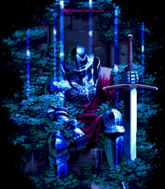

<!-- Badge Git e Banner centralizados -->

  <!-- Badge Git -->
  
  
  <!-- Banner de apresentação -->
  

---

<!-- Sobre mim -->

<h2 align="center">📊 Áreas de Interesse</h2>

  
  
  
  
  
  

  Graduando em Economia pela UFAL, com interesse em análise quantitativa, resolução de problemas e visualização de dados. 
  Assessor Técnico na Secretaria de Estado do Turismo de Alagoas (SETUR/AL), sempre em busca de oportunidades para aplicar conhecimentos em análise e interpretação de dados em projetos práticos.

  
  
  

---

<!-- Conecte-se comigo -->
<h3 align="left">🌐 Conecte-se comigo!</h3>

  
  

  <!-- LinkedIn -->
  

  <!-- Instagram -->
  

  <!-- Email -->
  

  <!-- League of Legends -->
  

  <!-- Tibia -->
  

---

 

  

  

---

<!-- TECH STACK -->
  <h3 align="left">💻 Tech Stack </h3>
<table>
  <tr>
    <td><b>Linguagens</b></td>
    <td>
      
      
      
      
    </td>
  </tr>
  <tr>
    <td><b>Ecossistema R</b></td>
    <td>
      
      
      
      
    </td>
  </tr>
  <tr>
    <td><b>ETL & Engenharia de Dados</b></td>
    <td>
      
      
      
      
    </td>
  </tr>
  <tr>
    <td><b>Business Intelligence & Aplicações</b></td>
    <td>
      
      
    </td>
  </tr>
  <tr>
    <td><b>Versionamento & Desenvolvimento</b></td>
    <td>
     
    
    
    
    
    </td>
  </tr>
</table>

<!-- IDE, Produtividade e Tools -->

<h3 align="left">⚙️ IDEs, Produtividade &amp; Tools</h3>

 

---

<!-- Gráfico de Atividade -->

  

  

---

<h3 align="left">Confira também minhas outras análises clicando no ícone abaixo:</h3>

  

---

<!-- GIF Final centralizado -->

  

